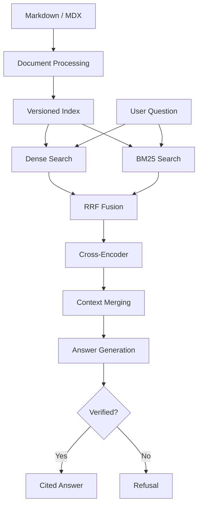

# Hybridix

A modular hybrid RAG engine that retrieves information from documentation and generates answers backed by verifiable citations.

The main idea is simple:

> Find the evidence. Answer only when it's supported.

## Features

- Markdown and MDX document ingestion
- Heading-aware chunking and token-budget handling
- Dense search with ChromaDB and sparse search with BM25S
- Hybrid retrieval using Reciprocal Rank Fusion (RRF)
- Cross-encoder reranking and adjacent context merging
- Structured answer generation with Groq
- Citation resolution, evidence verification, and refusal when evidence is insufficient
- Versioned, validated indexes and automated evaluation

## How It Works



Hybridix retrieves and reranks candidate chunks before merging adjacent evidence. Generated claims are linked to source chunks and checked by a separate verification step.

## Tech Stack

- Python 3.12+
- Sentence Transformers and Cross-Encoder
- ChromaDB and BM25S
- Groq (`openai/gpt-oss-120b` by default)
- Pydantic
- RAGAS and OpenAI (evaluation)
- Pytest, GitHub Actions, and uv

## Project Structure

```text
src/hybridix/
├── ingestion/
├── indexing/
│   └── versioning/
├── retrieval/
├── generation/
│   └── prompts/
├── evaluation/
├── cli.py
├── config.py
├── models.py
└── pipeline.py

data/eval/
scripts/
tests/
├── integration/
└── unit/
```

## Setup

Clone the repository and install dependencies:

```bash
git clone https://github.com/alihassanwarsi/hybridix.git
cd hybridix
uv sync
```

Copy `.env.example` to `.env` and configure your Groq API key:

```env
HYBRIDIX_GROQ_API_KEY=your_groq_api_key
HYBRIDIX_GENERATION_MODEL=openai/gpt-oss-120b
```

Other settings are listed in [`.env.example`](.env.example).

## Usage

Place your own `.md` or `.mdx` documents inside a folder such as `docs/`. The Discord documentation used for benchmarking is **not included** in this repository.

Index the documents:

```bash
uv run hybridix ingest docs --dry-run
uv run hybridix ingest docs
```

Ask a question:

```bash
uv run hybridix ask "How should an app handle Discord HTTP 429?"
```

Use `--debug` to inspect retrieved evidence and refusal details.

## Evaluation

Hybridix was evaluated on curated Discord Developer Documentation questions. These numbers describe that benchmark, not guaranteed results on other document collections.

### Retrieval (50 questions, Top 5)

| Method | Hit@5 | MRR@5 |
| --- | ---: | ---: |
| Dense | 90% | 0.705 |
| BM25S | 92% | 0.793 |
| Hybrid (RRF) | 94% | 0.765 |
| **Hybrid + Reranking** | **96%** | **0.850** |

Run the retrieval benchmark against a locally indexed copy of the evaluation corpus:

```bash
uv run hybridix evaluate --dataset data/eval/retrieval_dataset.jsonl --top-k 5
```

### Answer Quality (50 questions)

- **40/41** answerable questions received an answer; one was incorrectly refused.
- **9/9** expected refusals were handled correctly.
- **0** recorded execution errors.

RAGAS scored the 40 generated answers using `gpt-4.1-mini` as the judge:

| Metric | Score |
| --- | ---: |
| Faithfulness | **0.959** |
| Answer Relevancy | **0.879** |
| Factual Correctness (F1) | **0.777** |
| Citation Validity | **40/40** |

Citation checks verify references, not factual accuracy. Factual Correctness F1 compares generated answers with reference answers. Evaluation tools are in [`src/hybridix/evaluation/`](src/hybridix/evaluation/). RAGAS requires an OpenAI API key and the optional `eval` dependencies (`--extra eval`).

## Tests

Run the test suite, including RAGAS evaluator tests:

```bash
uv run --extra eval pytest
```

Tests also run through GitHub Actions on pushes and pull requests.

## Known Limitations

- Only local Markdown (`.md`) and MDX (`.mdx`) files are supported; no PDF ingestion or web UI yet.
- Answer generation and verification require a Groq API key and are subject to API rate limits.
- Some answers omit important details, and one benchmark question (`qa_031`) is incorrectly refused.
- Benchmarks use a curated documentation corpus and are not a guarantee of accuracy on other datasets.

## Future Work

- Improve retrieval quality and ranking across different document collections.
- Improve answer completeness and reduce unnecessary refusals.
- Support additional document formats, including PDF.
- Add support for more vector databases and flexible storage backends.
- Support multiple LLM providers and local models.
- Expand evaluation across different datasets and document collections.
